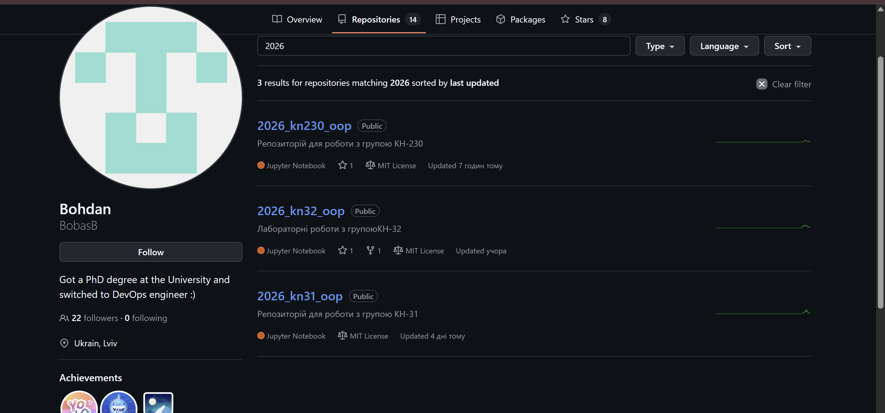
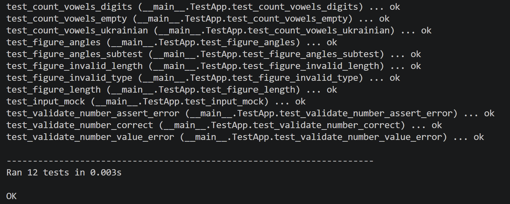

# **Тема:** Загальне тестування та юніт-тести в Python
## **Мета:** Ознайомитись з основами написання юніт-тестів за допомогою модуля unittest, навчитися використовувати перевірки assert, генерувати винятки raise ValueError та застосовувати розширені можливості тестування, такі як subTest і mock.
### Виконання роботи:
- ### Приклади, які розглядали на лекції
Нажаль, я не знайшла наш репозиторій

- ### **Завдання 1: Перевірка даних (assert та ValueError)**
- Розроблено власну функцію validate_number, яка перевіряє, чи є переданий аргумент числом та чи не є він від'ємним.

- У разі правильного введення (validate_number(5)) програма повертає число 5.

- У разі неправильного введення рядка (validate_number("abc")) генерується ValueError ("Введене значення має бути числом!").

- При введенні від'ємного числа (validate_number(-5)) спрацьовує AssertionError ("Число не може бути від'ємним!").
- ### **завдання 2: Тестування функцій**
Створено функцію count_vowels, яка обчислює кількість голосних літер у переданому рядку. Написано три тести:

1. Для порожнього рядка: self.assertEqual(0, count_vowels(""))

2. Для рядка з цифрами: self.assertEqual(0, count_vowels("1234567890"))

3. Для рядка з українськими літерами: self.assertEqual(3, count_vowels("привіт, світ"))

Усі тести виконуються успішно.
- ### **завдання 3: Тестування класу Figure (Перший приклад)**
Під час аналізу властивості get_figure_length у класі Figure було виявлено помилку: функція повертала неправильне значення (помножене на 2). Помилку виправлено, тепер метод коректно повертає self.length. Тест test_figure_length після виправлення проходить успішно.

Додано метод get_angles та тести для нього:

- Для квадрата та прямокутника очікується 4 кути.

- Для трикутника — 3 кути.
Додано граничні тести: перевірка винятку ValueError при нульовій довжині, від'ємній довжині, а також при переданні невідомого типу фігури.
- ### **завдання 4: Розширені можливості (subTest та mock)**
Пояснення призначення subTest та mock:
- subTest дозволяє об'єднати перевірку кількох значень у межах одного методу, проходячись циклом по словнику. Якщо якийсь із типів фігур викличе помилку, тест покаже, на якому саме типі вона сталася, не перериваючи перевірку інших.

- mock (через декоратор @patch) застосовано для підміни стандартної функції input(). Це дозволяє автоматично передавати значення під час виклику функції без реального очікування вводу від користувача з клавіатури.

[посилання на файл з програмою](app.py)

[посилання на файл з програмою](test.py)

Результат виконання тестів:

### **Висновок:**

- Що зроблено в роботі: Опановано методику написання юніт-тестів для перевірки працездатності коду. Написано тести для окремих функцій та методів класів, оброблено виняткові ситуації.

- Чи досягнуто мети роботи: Так, мету роботи повністю досягнуто.

- Які нові знання отримано: Навчились використовувати бібліотеку unittest, конструкції assert та raise ValueError для валідації даних, а також розширені інструменти тестування: subTest для циклічних перевірок та patch (mock) для симуляції користувацького вводу.

- Чи вдалось відповісти на всі питання задані в ході роботи: Так, усі аспекти тестування були розглянуті та реалізовані в коді.

- Чи вдалося виконати всі завдання: Так, виконано основні завдання, а також завдання підвищеної складності (із зірочками та вогниками).

- Чи виникли складності у виконанні завдання: Труднощів не виникло, інструментарій unittest виявився логічним та зручним для автоматизації перевірок.