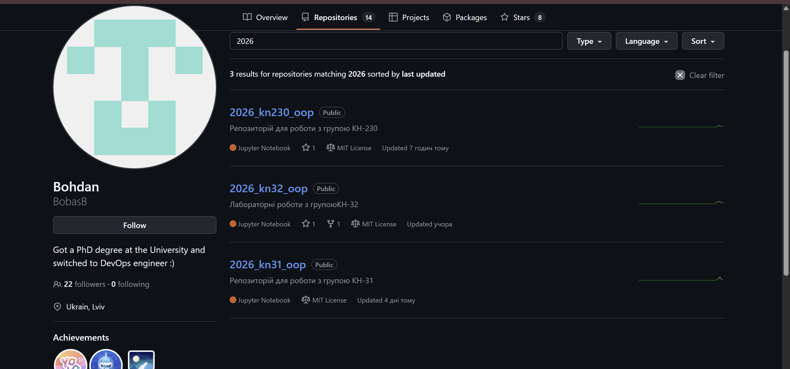
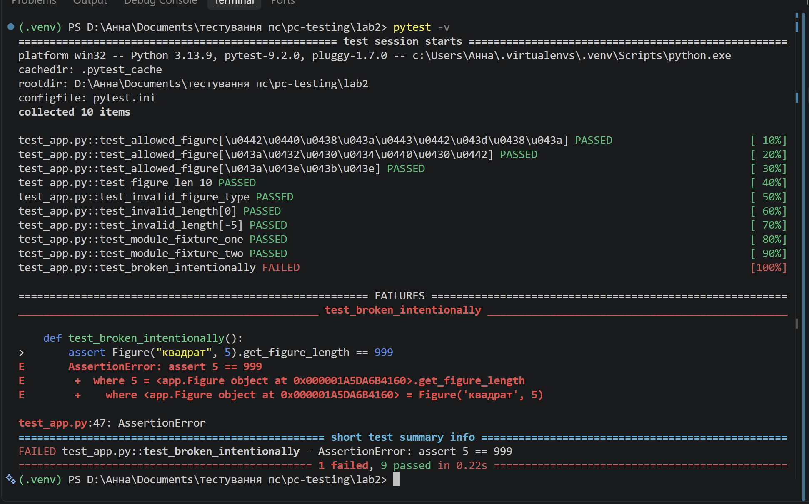
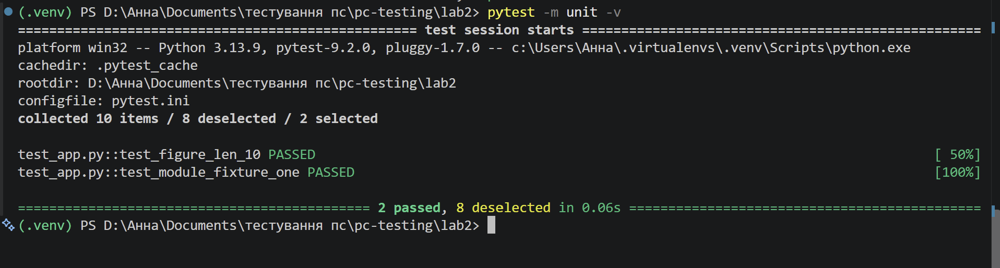
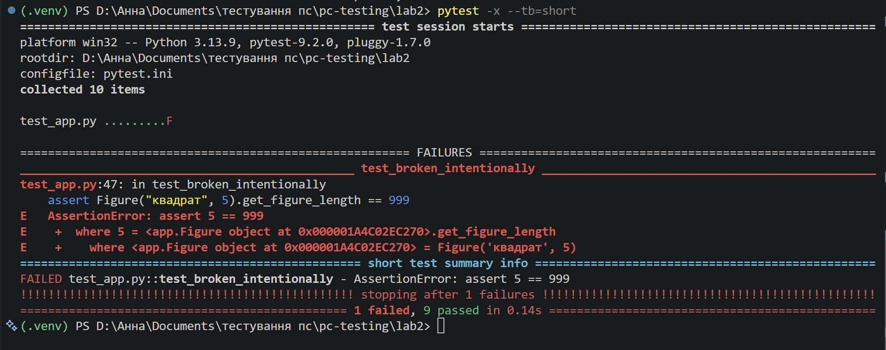

# **Тема:** Тестування з бібліотекою pytest
## **Мета:** Ознайомитись з основами написання тестів за допомогою бібліотеки pytest, навчитися створювати параметризовані тести, використовувати фікстури (fixtures) з різним scope, застосовувати маркери та аналізувати результати виконання тестів.
### Виконання роботи:
- ### Приклади, які розглядали на лекції
Нажаль, я не знайшла наш репозиторій

- ### **Завдання 1: Основи**
Створено базову структуру проекту для тестування класу Figure за допомогою сторонньої бібліотеки pytest.
- Створено віртуальне середовище та встановлено бібліотеку командою: pip install pytest
- Створено файл test_app.py, в якому написані тести з префіксом test_. На відміну від unittest, pytest дозволяє використовувати звичайний оператор assert.
- Реалізовано перевірку на винятки за допомогою конструкції with pytest.raises(AssertionError): для перевірки реакції на неправильну довжину (0 або -5) та неправильний тип фігури ("ромб").

- ### **завдання 2: Параметризація та фікстури (світильники)**
Застосовано декоратор @pytest.mark.parametrize для запуску одного тесту з кількома наборами даних:
- test_allowed_figure автоматично перевіряє всі типи фігур з масиву (трикутник, квадрат, коло), що дозволяє уникнути дублювання коду.
- test_invalid_length параметризовано для перевірки невалідних значень довжини (0 та -5).
Створено фікстури (@pytest.fixture) для підготовки тестових даних:
- Створено фікстуру figure_len_10, яка ініціалізує та повертає квадрат із довжиною 10.
- Створено тест test_figure_len_10, який запитує цю фікстуру як аргумент та перевіряє її властивості.

- ### **завдання 3: Розширені можливості тестування (scope, маркери, ключі запуску)**
Використано розширені налаштування pytest для оптимізації запуску:
- Створено фікстуру зі scope="module" (allowed_figures). Вона створюється один раз на рівні модуля і успішно перевикористовується у двох різних тестах (test_module_fixture_one та test_module_fixture_two).
- Додано кастомний маркер @pytest.mark.unit до двох тестів. Маркер зареєстровано у файлі pyproject.toml. За допомогою команди pytest -m unit ці тести було успішно запущено окремо від інших.
- Додано навмисно зламаний тест test_broken_intentionally (очікує довжину 999 замість 5). Команда pytest -x --tb=short миттєво зупинила виконання на цій помилці та вивела скорочений лог (traceback), що полегшує пошук причини збою.

[посилання на файл з програмою](app.py)

[посилання на файл з тестами](test_app.py)

Результат виконання тестів (pytest -v):

Результат виконання відфільтрованих тестів (pytest -m unit -v):

Результат миттєвої зупинки на помилці (pytest -x --tb=short):

### **Висновок:**
- Що зроблено в роботі: Опановано методику написання тестів за допомогою сторонньої бібліотеки pytest. Написано параметризовані тести, створено фікстури різного рівня видимості (scope), налаштовано маркери для вибіркового запуску та відпрацьовано команди консолі для аналізу логів.
- Чи досягнуто мети роботи: Так, мету роботи повністю досягнуто.
- Які нові знання отримано: Навчились використовувати pytest для лаконічного написання тестів за допомогою assert. Опанували @pytest.mark.parametrize для тестування наборів даних, @pytest.fixture для підготовки середовища та маркери (pytest -m) для маршрутизації запуску. Ознайомились із ключами -x та --tb=short для оптимізації дебаггінгу.
- Чи вдалось відповісти на всі питання задані в ході роботи: Так, усі аспекти тестування (включно із завданнями підвищеної складності) були реалізовані та перевірені.
- Чи вдалося виконати всі завдання: Так, виконано всі основні завдання, а також завдання із зірочками та вогниками (параметризація, фікстури, перевірка невалідних типів/довжин, маркери, зламаний тест).
- Чи виникли складності у виконанні завдання: Труднощів не виникло, pytest виявився значно зручнішим та лаконічнішим інструментом у порівнянні зі стандартним модулем unittest.