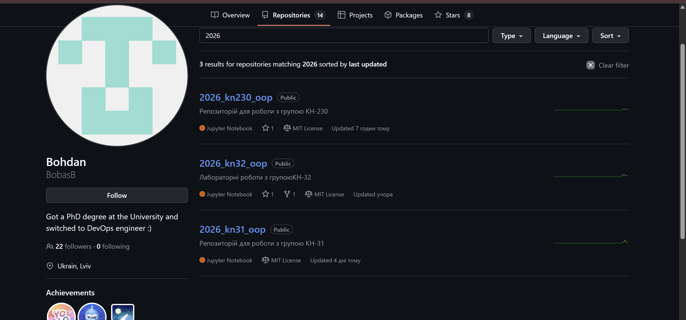
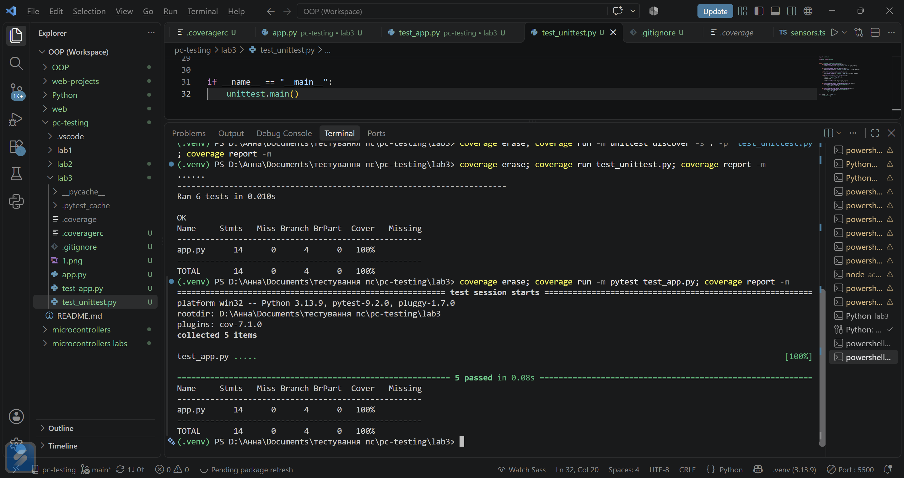
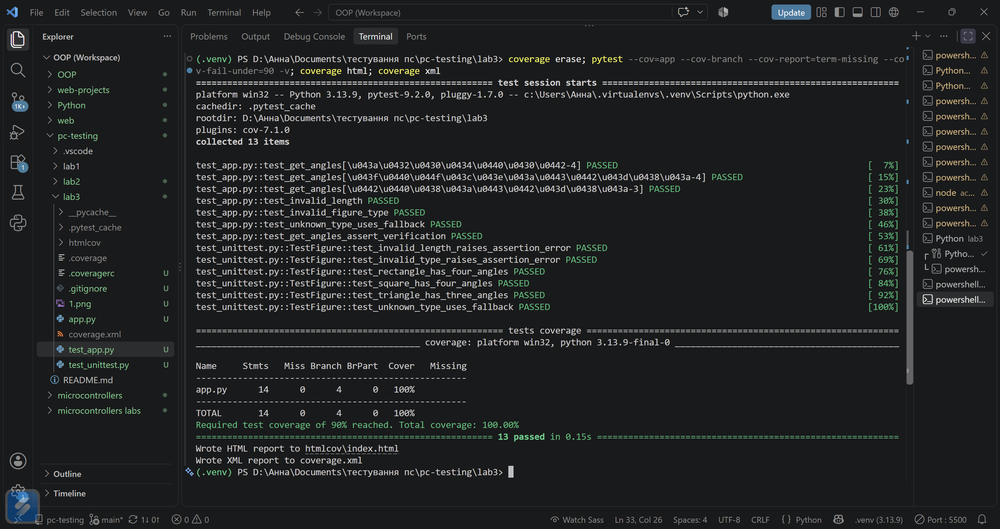
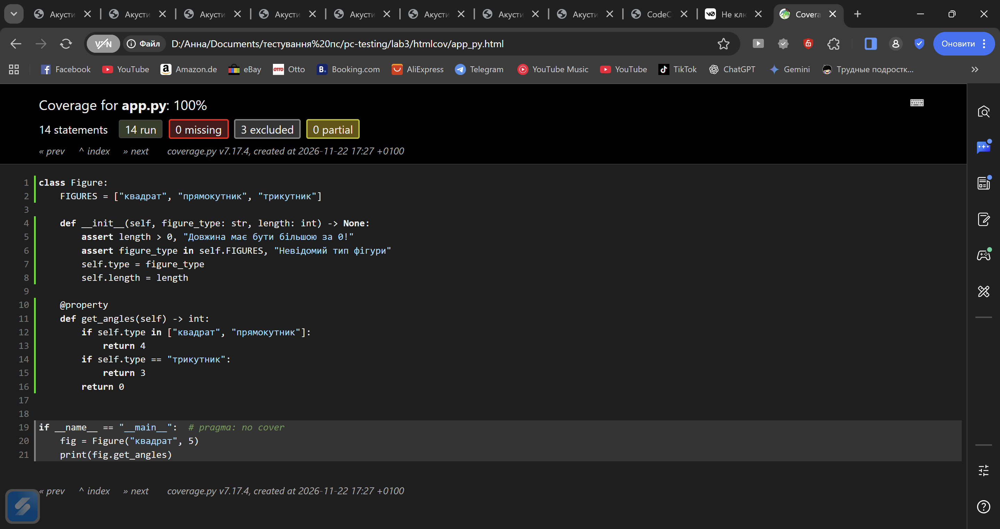

# **Тема:** Покриття коду тестами (Code Coverage) у Python
## **Мета:** Ознайомитися з інструментами вимірювання покриття коду (`coverage.py`, `pytest-cov`), навчитися аналізувати покриття рядків (Line coverage) та розгалужень (Branch coverage), налаштовувати конфігурацію `.coveragerc`, використовувати виключення `# pragma: no cover` та генерувати HTML- і XML-звіти.
### Виконання роботи:
- ### Приклади, які розглядали на лекції
На жаль, я не знайшла наш репозиторій

- ### **Завдання 1: Окремий запуск `unittest` та `pytest` і аналіз покриття**
Для вимірювання покриття кожного набору тестів окремо використовувалося попереднє очищення файлу статистики `.coverage`:

```bash
coverage erase; coverage run test_unittest.py; coverage report -m
coverage erase; coverage run -m pytest test_app.py; coverage report -m
```
Порівняння запусків та різниця між покриттям рядків і розгалужень:
- Line coverage (покриття рядків) показує, чи був кожен виконуваний оператор (`Stmts`) запущений хоча б один раз під час виконання тестів.
- Branch coverage (покриття розгалужень) перевіряє, чи пройшли тести обидва напрямки кожного умовного переходу (`True` та `False` у конструкціях `if` та `assert`). Навіть якщо рядок з умовою виконався, без перевірки альтернативної гілки виникає часткове покриття переходів (`BrPart`).
- Під час окремого запуску `unittest` (`test_unittest.py`, 6 тестів) та `pytest` (`test_app.py`, 5 тестів) покриття `app.py` склало 100% (`Stmts` = 14, `Miss` = 0, `Branch` = 4, `BrPart` = 0).   
Результат окремих запусків unittest та pytest:

- ### **завдання 2: Покриття розгалужень, налаштування `.coveragerc` та `pragma: no cover`**
- Аналіз розгалужень `get_angles`: У класі `Figure` (`app.py`) властивість `get_angles` містить умовні переходи для фігур `"квадрат"` та `"прямокутник"` (повертають 4), `"трикутник"` (повертає 3), а також резервне повернення 0 для невідомого типу фігури. Якби тестувався лише один тип фігури (наприклад, трикутник), інші гілки умов залишилися б непокритими у стовпці `Missing`. Завдяки тестам для всіх типів фігур та перевіркам помилок `AssertionError` досягнуто 100% покриття рядків і розгалужень.   
- Налаштування `.coveragerc`: У файлі `.coveragerc` у секції [run] задано `source = .` та `branch = true`, а в секції [report] через параметр omit виключено тестові та службові файли (`test_*.py`, `*/tests/*`, `*/__init__.py`, `*/.venv/*`). Завдяки цьому у таблиці звіту відображається виключно цільовий модуль `app.py`.   
- Використання `pragma: no cover`: До точки входу скрипта `if __name__ == "__main__"`: додано коментар `# pragma: no cover`, оскільки цей блок відповідає лише за ручний запуск файлу з консолі й не є частиною тестованої бізнес-логіки. Це дозволило виключити службові рядки з розрахунку покриття без штучного завищення показників основної логіки програми.   
Запуск тестів із перевіркою мінімального порогу покриття (`--cov-fail-under=90`):
```Bash
coverage erase; pytest --cov=app --cov-branch --cov-report=term-missing --cov-fail-under=90 -v
```
Результат перевірки порогу покриття та застосування `pragma: no cover`:

- ### **завдання 3: HTML та XML звіти**
Згенеровано звіти у двох форматах:

```Bash
coverage html
coverage xml
```
- HTML-звіт (`htmlcov/index.html`) призначений для людей (розробників і тестувальників) — він наочно підсвічує у браузері виконані (зелені), пропущені (червоні) та виключені через `pragma: no cover` (сірі) рядки безпосередньо в тексті коду.

- XML-звіт (`coverage.xml`) призначений для інструментів автоматизації та CI/CD-систем (GitHub Actions, SonarQube, Codecov) для автоматичного зчитування метрик покриття та блокування збірки при падінні показників нижче встановленого порогу.

Візуалізація покриття коду у браузері (`htmlcov/index.html`):

- ### **завдання 4: Чого coverage не доводить**
Під час експерименту створено тест `test_get_angles_assert_verification`, у якому спочатку викликається властивість `figure.get_angles` без оператора `assert`. Інструмент `coverage` зафіксував виконання всіх рядків методу як 100% покриття, проте без `assert` тест лише підтверджує відсутність винятків під час виконання і не виявить логічну помилку, якщо метод поверне неправильну кількість кутів.

Після додавання перевірки `assert figure.get_angles == 3` тест почав гарантувати відповідність результату очікуваному значенню. Таким чином, 100% line coverage не означає відсутності помилок у програмі — воно лише показує, що в коді немає невиконаних рядків, але якість тестування визначається повнотою перевірок `assert` та граничних випадків.


[посилання на файл з програмою](app.py)

[посилання на файл з тестами pytest](test_app.py)

[посилання на файл з тестами unittest](test_unittest.py)

[посилання на конфігурацію coverage](.coveragerc)

### **Висновок:**

У ході лабораторної роботи було опановано методику вимірювання покриття коду в Python за допомогою `coverage.py` та `pytest-cov`. На практиці підтверджено різницю між покриттям рядків (Line coverage) і розгалужень (Branch coverage), налаштовано виключення тестових і службових файлів через `.coveragerc` та `# pragma: no cover`, сформовано HTML- і XML-звіти, а також доведено, що високий відсоток покриття має поєднуватися зі змістовними перевірками `assert`.