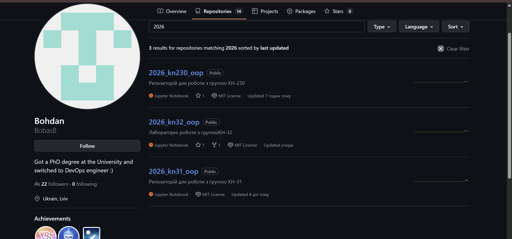
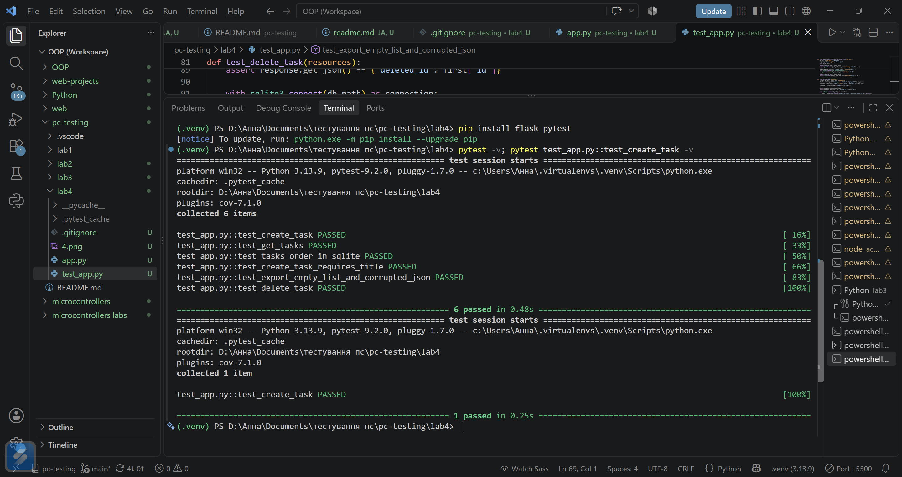

# **Тема:** Інтеграційне тестування у Python (Flask, SQLite, JSON)
## **Мета:** Ознайомитися з принципами інтеграційного тестування на прикладі вебзастосунку Flask, навчитися перевіряти спільну роботу HTTP-маршрутів, бази даних SQLite та файлової системи з використанням фікстури tmp_path.
### Виконання роботи:
- ### Приклади, які розглядали на лекції
На жаль, я не знайшла наш репозиторій

- ### **Завдання 1: Встановлення залежностей та запуск інтеграційних тестів**
Для роботи з вебзастосунком та запуску тестів встановлено бібліотеки flask і pytest:

```bash
pip install flask pytest
```
Запуск усіх тестів та окремого тесту test_create_task:

```Bash
pytest -v
pytest test_app.py::test_create_task -v
```
Різниця між юніт-тестом, інтеграційним та системним тестом:

- Юніт-тест перевіряє одну функцію або метод ізольовано від зовнішніх залежностей (зазвичай із використанням mock-об'єктів).

- Інтеграційний тест перевіряє спільну роботу кількох компонентів програми без підміни бази даних чи файлової системи (у роботі використано тимчасову папку tmp_path, яка очищується автоматично після кожного тесту).

- Системний тест перевіряє застосунок цілісно у середовищі, наближеному до реальної експлуатації кінцевим користувачем.

Результат виконання інтеграційних тестів у терміналі:

- ### **Завдання 2: Взаємодія компонентів у кожному тесті**
- test_create_task: Перевіряє повний сценарій створення завдання: надсилання POST /tasks через тестовий клієнт Flask (статус 201 та JSON-відповідь), запис рядка у тимчасову таблицю tasks бази даних SQLite та експорт оновленого списку у файл tasks.json.

- test_get_tasks та test_tasks_order_in_sqlite: Перевіряють збереження двох послідовних завдань у SQLite, їхній порядок сортування за id безпосередньо в таблиці бази даних та коректність видачі списку через GET /tasks (статус 200).

- test_create_task_requires_title: Перевіряє валідацію вхідних даних при POST-запиті без поля title — сервер повертає статус 400 із повідомленням про помилку, а файл tasks.json не створюється.

- test_export_empty_list_and_corrupted_json: Перевіряє роботу функції export_tasks із порожньою базою даних (формування порожнього JSON-масиву []), виникнення винятку json.JSONDecodeError при читанні пошкодженого JSON-файла та відновлення коректного вмісту при повторному експорті.

- test_delete_task: Перевіряє роботу доданого маршруту DELETE /tasks/<int:task_id> — видалення запису з таблиці SQLite, оновлення вмісту файлу tasks.json (статус 200) та повернення помилки 404 при спробі видалити неіснуючий запис.

[посилання на файл з програмою](app.py)

[посилання на файл з тестами](test_app.py)

### **Висновок:**
У ході лабораторної роботи було опановано методику написання інтеграційних тестів на Python для вебзастосунку Flask із реальною базою даних SQLite та файловою системою. За допомогою фікстури tmp_path забезпечено ізольоване тестування без зміни робочих даних, а також перевірено повний ланцюжок взаємодії від HTTP-запитів (GET, POST, DELETE) до збереження та оновлення даних у SQLite і JSON-файлі.