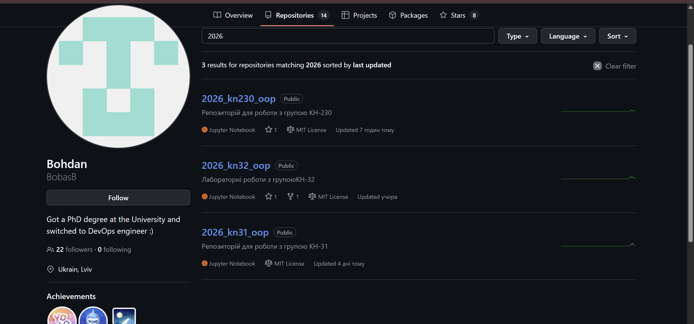
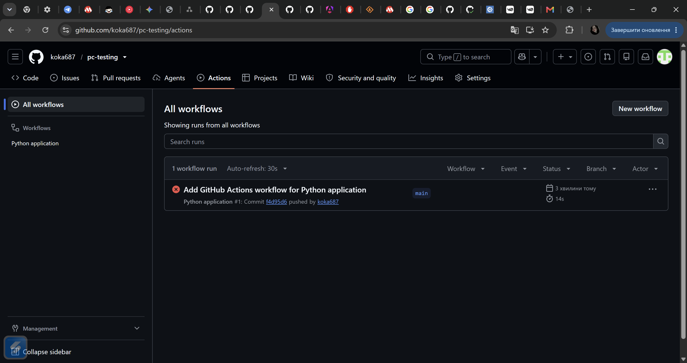
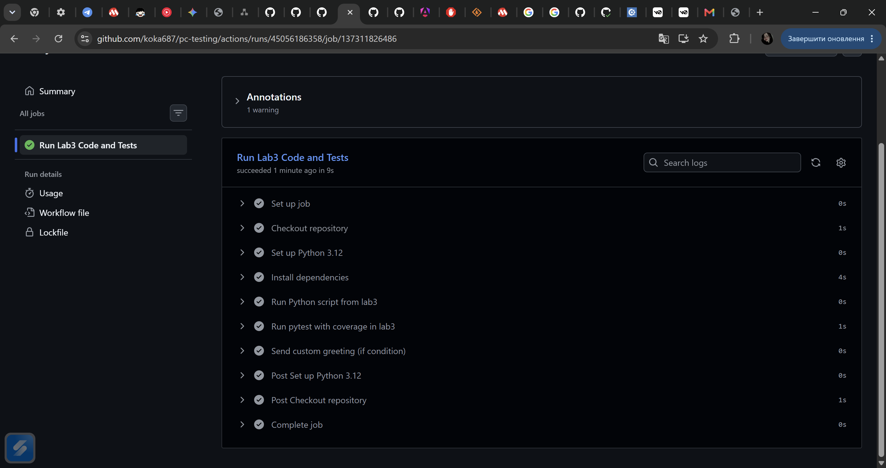
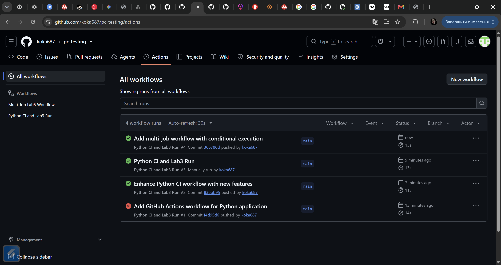
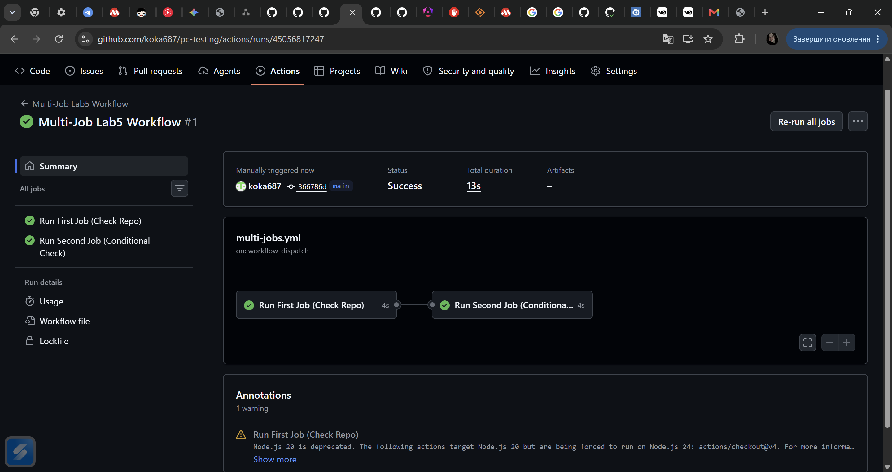

# **Тема:** Автоматизація процесів CI/CD за допомогою GitHub Actions
## **Мета:** Ознайомитися з можливостями автоматизації у GitHub Actions, навчитися створювати Workflow на основі шаблонів та вручну у форматі YAML, налаштовувати ручний запуск (`workflow_dispatch`) із вхідними параметрами, запуск за розкладом (`schedule` / `cron`), багатозадачні пайплайни (`jobs`), умовне виконання кроків (`if`) та додавати бейджі статусів до `README.md`.

### Виконання роботи:

- ### Приклади, які розглядали на лекції
На жаль, я не знайшла наш репозиторій

- ### **Завдання 1: Створення першого Workflow із шаблону**
У вкладці `Actions` репозиторію обрано стандартний шаблон `Python application` та створено конфігураційний файл `.github/workflows/python-app.yml`. Після коміту новий Workflow з'явився у списку доступних автоматизацій репозиторію.

Відображення створеного Workflow у вкладці `Actions`:

- ### **Завдання 2: Редагування Workflow, ручний запуск (`workflow_dispatch`), розклад (`cron`) та умови (`if`)**
Файл `.github/workflows/python-app.yml` модифіковано під проєкт:
1. **Запуск попередньої лабораторної роботи:** Додано кроки встановлення залежностей (`pytest`, `coverage`, `pytest-cov`), прямого запуску скрипта `python ./lab3/app.py` та виконання тестів із перевіркою покриття коду в директорії `lab3`.
2. **Ручний запуск із параметром (`workflow_dispatch`):** Налаштовано тригер `workflow_dispatch` із вхідним параметром `student_name` (значення за замовчуванням — `"Executer"`).
3. **Запуск за розкладом (`schedule`):** За допомогою виразу `cron: '30 10 * * 1'` налаштовано автоматичний запуск щопонеділка о 10:30 UTC (один раз на тиждень для економії безкоштовних хвилин GitHub Actions).
4. **Умовне виконання кроку (`if`):** Додано крок `Send custom greeting`, який виконується лише за умови `github.event.inputs.student_name != 'Executer' && github.event_name == 'workflow_dispatch'`. Під час ручного запуску передано значення `Anna`, і крок успішно вивів привітання у лог.

Результат виконання кроків запуску `lab3/app.py`, тестів `pytest` та умови `if`:

- ### **Завдання 3: Створення кількох Workflow та багатозадачних `jobs`**
Для демонстрації роботи кількох незалежних пайплайнів у директорії `.github/workflows/` створено другий файл — `multi-jobs.yml` із назвою `Multi-Job Lab5 Workflow`.

Відображення двох Workflow у вкладці `Actions`:

У файлі `multi-jobs.yml` описано два послідовні завдання (`jobs`):
- `job_one` (`Run First Job`) — завантажує код репозиторію та виводить повідомлення про успішний старт.
- `job_two` (`Run Second Job`) — залежить від першого завдання (`needs: job_one`) та виконується за умовою `if: github.event.inputs.run_second == 'yes'`.

Результат виконання кількох `jobs` у графі Workflow:

- ### **Завдання 4: Додавання бейджів статусів (Status Badges)**
Через меню `Create status badge` у вкладці `Actions` згенеровано Markdown-код індикаторів стану для обох Workflow (`Python CI and Lab3 Run` та `Multi-Job Lab5 Workflow`) та додано їх на початок файлу `README.md` для візуального відображення актуального статусу збірок.

---

[посилання на перший Workflow (python-app.yml)](../.github/workflows/python-app.yml)

[посилання на другий Workflow (multi-jobs.yml)](../.github/workflows/multi-jobs.yml)

### **Висновок:**
У ході лабораторної роботи було опановано налаштування безперервної інтеграції (CI) за допомогою GitHub Actions. На практиці створено та протестовано два YAML-файли Workflow, налаштовано запуск коду та автотестів із попередньої лабораторної роботи, реалізовано тригери `push`, `workflow_dispatch` із вхідними параметрами та розклад `cron`, перевірено роботу умовних операторів `if` між кроками та `jobs`, а також додано динамічні бейджі статусів до звіту `README.md`.
